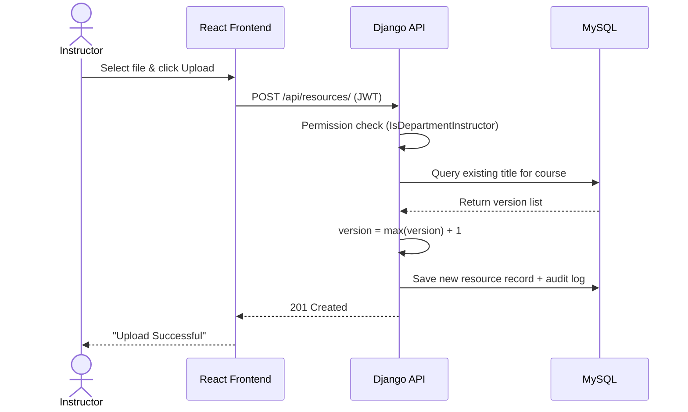

<div align="center">

# 🎓 MU-CLRIS
### Mekelle University Centralized Local Resource and Information Sharing System

**A secure, LAN-first academic repository that keeps learning materials and announcements available even when the campus internet goes down.**


*Senior Capstone Project, B.Sc. in Information Technology, Mekelle Institute of Technology (MIT), Mekelle University, May 2026*

</div>

---

## 📌 Overview

Academic resource sharing at Mekelle University relies on informal channels: Telegram groups, physical notice boards and USB flash drives. These are exposed to **information decay, version conflicts, connectivity dependence and weak access control**.

**MU-CLRIS** replaces them with a centralized, role-aware web platform deployed over the university's **Local Area Network (LAN)**, so students and instructors can reach materials without any external internet connection.

| Problem | MU-CLRIS Solution |
|---|---|
| Updates buried in social-media noise | Centralized digital announcement board, scoped by department |
| Multiple conflicting document copies | Automated, per-course resource versioning |
| Cloud tools fail during outages | LAN-hosted architecture with no external runtime dependency |
| Sensitive material poorly protected | JWT + Role-Based Access Control + departmental data isolation |
| No accountability for changes | Audit logging of critical actions |

---

## 🖼️ Screenshots

| Login | Student Dashboard |
|:---:|:---:|
|  |  |

| Instructor Dashboard | Admin Dashboard |
|:---:|:---:|
|  |  |

---

## 🏗️ Architecture

MU-CLRIS uses a **decoupled client-server architecture**: a React single-page application communicates with a Django REST API over the LAN.

```
┌──────────────────────┐   HTTPS/HTTP + JWT    ┌─────────────────────────┐   ORM    ┌──────────────┐
│  React SPA (Vite)    │ ────────────────────► │ Django REST Framework   │ ───────► │    MySQL     │
│  Tailwind CSS        │ ◄──────────────────── │  • JWT auth             │ ◄─────── │  (relational │
│  Role-aware UI       │      JSON responses   │  • Permission classes   │          │   integrity) │
└──────────────────────┘                       │  • Versioning logic     │          └──────────────┘
                                               │  • Signals / Audit log  │
                                               └───────────┬─────────────┘
                                                           │
                                                  Local media storage
                                                  (uploaded resources)
```

### Request Flow: Resource Upload



### Data Model

| Entity | Primary Key | Foreign Keys | Purpose |
|---|---|---|---|
| `User` | `id` | `department` | Credentials, role, department |
| `Department` | `id` | n/a | Academic departments |
| `Course` | `id` | `department` | Courses within a department |
| `Resource` | `id` | `course`, `uploaded_by` | File path, version, metadata |
| `Announcement` | `id` | `department` | Departmental announcements |
| `AuditLog` | `id` | `user` | Read-only record of critical actions |

---

## ✨ Features

### 🔐 Role-Based Access Control (RBAC)
- Stateless **JWT authentication**; the access token carries the user's role and department.
- Four roles: **System Admin, Department Admin, Instructor, Student**.
- Custom DRF permission classes (e.g. `IsDepartmentInstructor`) intercept requests; cross-department actions return **`403 Forbidden`**.
- The UI renders conditionally by role (e.g. the *Upload* control is removed from the DOM for students).

### 🗂️ Automated Resource Versioning
- On upload, the API checks for an existing resource with the same **title + course**.
- If found, the version increments (`V_new = V_current + 1`); otherwise it starts at **Version 1**.
- Older versions are preserved, giving a historical archive with no overwrites.

### 🏛️ Departmental Data Isolation
- Instructors and students can only interact with resources in their assigned department.

### 📢 Digital Announcement Board
- Authorized users post announcements visible to their department, replacing physical notice boards.

### 🧾 Audit Logging
- Django Signals (`post_save`, `pre_delete`) and explicit log entries record the user, action type and timestamp for administrative oversight.

### 🔎 Searchable Archive
- Department-specific, searchable library of lecture notes, references and exams.

---

## 🧠 Core Architecture Logic

The snippet below is the heart of the platform: **security enforcement and automated versioning in one atomic operation**. The standalone version lives in [`/code-snippets/versioning_logic.py`](./code-snippets/versioning_logic.py).

```python
from django.db import transaction
from rest_framework.exceptions import PermissionDenied, ValidationError

def perform_create(self, serializer):
    title = serializer.validated_data.get("title")
    course = serializer.validated_data.get("course")
    user = self.request.user

    # 1. Departmental data isolation
    if not user.is_staff and course.department != user.department:
        raise PermissionDenied(
            "You cannot upload a resource to another department's course."
        )

    uploaded_file = self.request.data.get("file")
    if uploaded_file is None:
        raise ValidationError({"file": "No file was submitted."})

    with transaction.atomic():
        # 2. Version logic: highest existing version for this title + course
        latest = (
            Resource.objects.select_for_update()
            .filter(title=title, course=course)
            .order_by("-version")
            .first()
        )
        new_version = latest.version + 1 if latest else 1

        # 3. Auto metadata extraction + single save
        resource = serializer.save(
            uploaded_by=user,
            version=new_version,
            file_size=uploaded_file.size,
            file_type=uploaded_file.name.rsplit(".", 1)[-1].upper(),
        )

        # 4. Audit trail
        AuditLog.objects.create(
            user=user, action="UPLOADED", resource_title=resource.title
        )
```

---

## 🧪 Testing

| ID | Scenario | Expected | Actual | Status |
|---|---|---|---|:---:|
| TC01 | Login with wrong credentials | 401 Unauthorized | 401 Unauthorized | ✅ |
| TC02 | Student attempts to delete a file | 403 Forbidden | 403 Forbidden | ✅ |
| TC03 | Upload a duplicate file name | Version increments | Version +1 | ✅ |
| TC04 | Request `/api/resources/` with no token | 401 Unauthorized | 401 Unauthorized | ✅ |
| TC05 | Law instructor deletes a Political Science file | 403 Forbidden | 403 Forbidden | ✅ |

Methods: Django `TestCase` unit tests, API/integration tests with Postman and HTTPie, and responsive UI testing across screen sizes.

---

## 🚀 Running the Project

This repository is a **project showcase**: it contains the documentation, architecture overview, screenshots and the core versioning algorithm. The full source code (Django backend and React frontend) is maintained with the project team and is **available on request** for academic or scholarship review.

### Tech requirements (for reference)
- Python 3.10+ with Django and Django REST Framework
- Node.js 18+ with React (Vite) and Tailwind CSS
- MySQL 8.0+

### Deployment model
The backend runs on a university server and the frontend is served over the Local Area Network (LAN). Users reach the system through the server's LAN IP address, so no external internet connection is required at runtime.

📧 To request access to the full source code, contact the author via GitHub: [@BK-NetSec](https://github.com/BK-NetSec).

---
## 🗺️ Roadmap

- [ ] Campus-wide scaling to all colleges and institutes
- [ ] Native mobile app with push notifications for urgent announcements
- [ ] Cloud synchronization module for off-site backup when internet is available
- [ ] Official deployment on a university ICT-managed server

---

## ⚠️ Limitations

- Optimized for documents and text; no video streaming or real-time messaging.
- Intended for intranet use; not hosted on a public domain.

---

## 👥 Team

Developed as a team capstone at the Department of Information Technology, MIT, Mekelle University.  
**Advisor:** Tuemay Assefa


---
### 👤 My Contribution: Bahabelom Kiros (Tomas)

As a member of the seven-person team, my work focused on security and network aspects of MU-CLRIS.

**🔐 Cybersecurity**
- Implemented JWT-based authentication so every API request requires a valid token (`401 Unauthorized` otherwise).
- Built role-based access control with custom permission classes (e.g. `IsDepartmentInstructor`) across four user roles.
- Enforced department-level data isolation, blocking cross-department actions with `403 Forbidden`.
- Configured password hashing (PBKDF2) for credential protection.

**🔎 Information Security**
- Implemented audit logging with Django Signals to record user, action and timestamp for accountability.
- Contributed to the automated versioning logic that preserves document integrity (no silent overwrites).
- Restricted unverified users to a limited view until an administrator assigns a role.

**🌐 Networking**
- Configured LAN deployment so the system runs without external internet access.
- Set up the client-server connection between the React frontend and the Django REST API over the local network.

**🧪 Security Testing**
- Tested access-control rules with Postman and HTTPie (unauthorized, forbidden and cross-department cases).
- Wrote Django unit tests for the versioning logic.

**Skills demonstrated:** authentication, access control, secure API design, audit logging, LAN deployment, security testing.

---
## 👤 Author

**Bahabelom Kiros (Tomas)**  
GitHub: [@BK-NetSec](https://github.com/BK-NetSec)
---

## 📄 License

Released for academic and portfolio purposes. Add a license (e.g. MIT) before public reuse.
