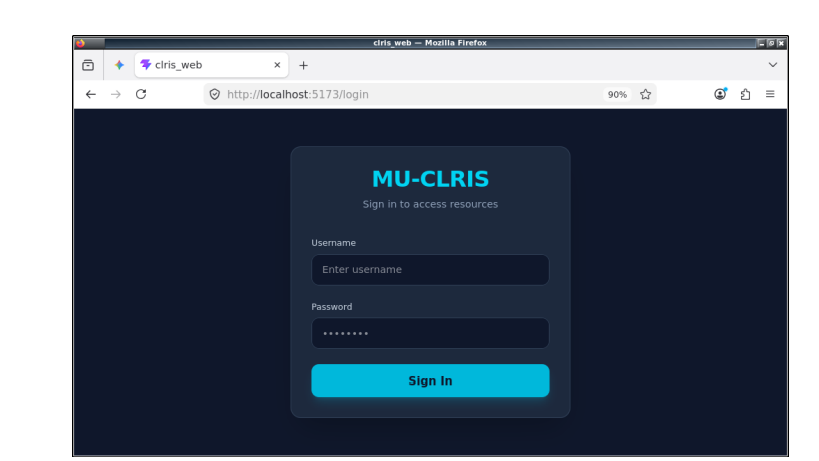
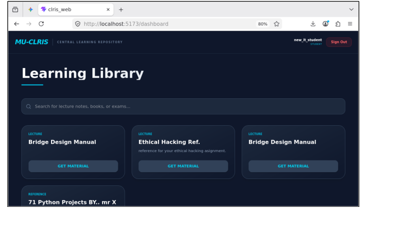
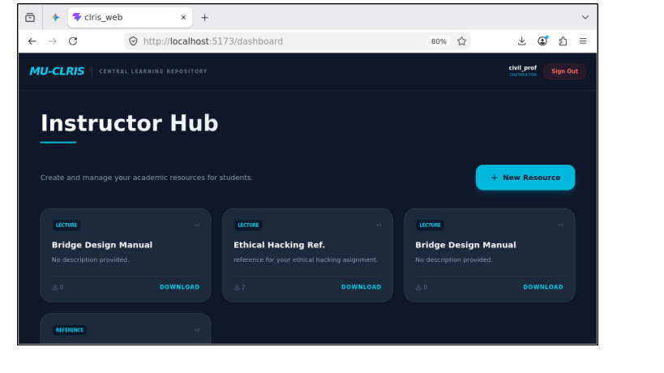
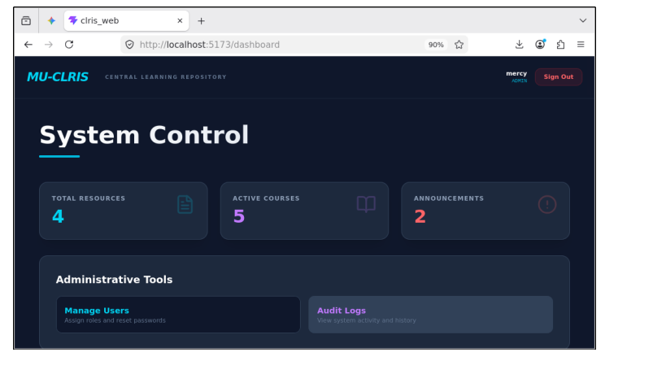
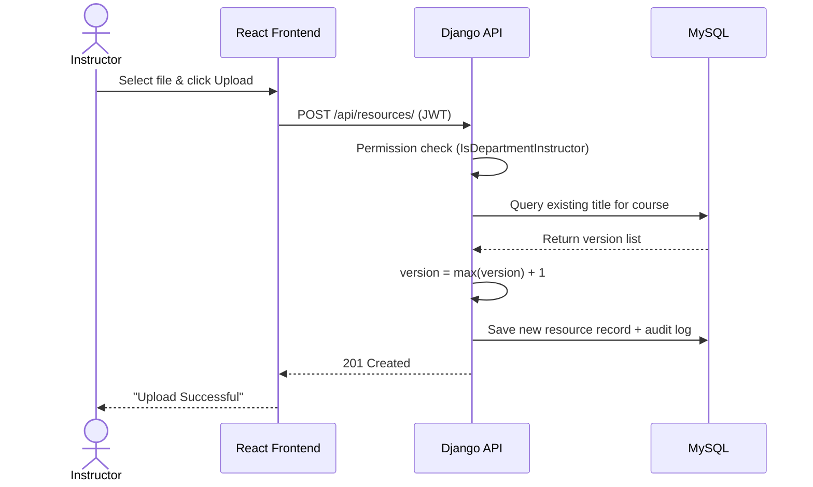

<div align="center">

# 🎓 MU-CLRIS
### Mekelle University Centralized Local Resource and Information Sharing System

**A secure, LAN-first academic repository that keeps learning materials and announcements available even when the campus internet goes down.**


*Senior Capstone Project, B.Sc. in Information Technology, Mekelle Institute of Technology (MIT), Mekelle University, May 2026*

</div>

---

## 📌 Overview

Academic resource sharing at Mekelle University relies on informal channels: Telegram groups, physical notice boards and USB flash drives. These are exposed to **information decay, version conflicts, connectivity dependence and weak access control**.

**MU-CLRIS** replaces them with a centralized, role-aware web platform deployed over the university's **Local Area Network (LAN)**, so students and instructors can reach materials without any external internet connection.

| Problem | MU-CLRIS Solution |
|---|---|
| Updates buried in social-media noise | Centralized digital announcement board, scoped by department |
| Multiple conflicting document copies | Automated, per-course resource versioning |
| Cloud tools fail during outages | LAN-hosted architecture with no external runtime dependency |
| Sensitive material poorly protected | JWT + Role-Based Access Control + departmental data isolation |
| No accountability for changes | Audit logging of critical actions |

---

## 🖼️ Screenshots

| Login | Student Dashboard |
|:---:|:---:|
|  |  |

| Instructor Dashboard | Admin Dashboard |
|:---:|:---:|
|  |  |

---

## 🏗️ Architecture

MU-CLRIS uses a **decoupled client-server architecture**: a React single-page application communicates with a Django REST API over the LAN.

```
┌──────────────────────┐   HTTPS/HTTP + JWT    ┌─────────────────────────┐   ORM    ┌──────────────┐
│  React SPA (Vite)    │ ────────────────────► │ Django REST Framework   │ ───────► │    MySQL     │
│  Tailwind CSS        │ ◄──────────────────── │  • JWT auth             │ ◄─────── │  (relational │
│  Role-aware UI       │      JSON responses   │  • Permission classes   │          │   integrity) │
└──────────────────────┘                       │  • Versioning logic     │          └──────────────┘
                                               │  • Signals / Audit log  │
                                               └───────────┬─────────────┘
                                                           │
                                                  Local media storage
                                                  (uploaded resources)
```

### Request Flow: Resource Upload



### Data Model

| Entity | Primary Key | Foreign Keys | Purpose |
|---|---|---|---|
| `User` | `id` | `department` | Credentials, role, department |
| `Department` | `id` | n/a | Academic departments |
| `Course` | `id` | `department` | Courses within a department |
| `Resource` | `id` | `course`, `uploaded_by` | File path, version, metadata |
| `Announcement` | `id` | `department` | Departmental announcements |
| `AuditLog` | `id` | `user` | Read-only record of critical actions |

---

## ✨ Features

### 🔐 Role-Based Access Control (RBAC)
- Stateless **JWT authentication**; the access token carries the user's role and department.
- Four roles: **System Admin, Department Admin, Instructor, Student**.
- Custom DRF permission classes (e.g. `IsDepartmentInstructor`) intercept requests; cross-department actions return **`403 Forbidden`**.
- The UI renders conditionally by role (e.g. the *Upload* control is removed from the DOM for students).

### 🗂️ Automated Resource Versioning
- On upload, the API checks for an existing resource with the same **title + course**.
- If found, the version increments (`V_new = V_current + 1`); otherwise it starts at **Version 1**.
- Older versions are preserved, giving a historical archive with no overwrites.

### 🏛️ Departmental Data Isolation
- Instructors and students can only interact with resources in their assigned department.

### 📢 Digital Announcement Board
- Authorized users post announcements visible to their department, replacing physical notice boards.

### 🧾 Audit Logging
- Django Signals (`post_save`, `pre_delete`) and explicit log entries record the user, action type and timestamp for administrative oversight.

### 🔎 Searchable Archive
- Department-specific, searchable library of lecture notes, references and exams.

---

## 🧠 Core Architecture Logic

The snippet below is the heart of the platform: **security enforcement and automated versioning in one atomic operation**. The standalone version lives in [`/code-snippets/versioning_logic.py`](./code-snippets/versioning_logic.py).

```python
from django.db import transaction
from rest_framework.exceptions import PermissionDenied, ValidationError

def perform_create(self, serializer):
    title = serializer.validated_data.get("title")
    course = serializer.validated_data.get("course")
    user = self.request.user

    # 1. Departmental data isolation
    if not user.is_staff and course.department != user.department:
        raise PermissionDenied(
            "You cannot upload a resource to another department's course."
        )

    uploaded_file = self.request.data.get("file")
    if uploaded_file is None:
        raise ValidationError({"file": "No file was submitted."})

    with transaction.atomic():
        # 2. Version logic: highest existing version for this title + course
        latest = (
            Resource.objects.select_for_update()
            .filter(title=title, course=course)
            .order_by("-version")
            .first()
        )
        new_version = latest.version + 1 if latest else 1

        # 3. Auto metadata extraction + single save
        resource = serializer.save(
            uploaded_by=user,
            version=new_version,
            file_size=uploaded_file.size,
            file_type=uploaded_file.name.rsplit(".", 1)[-1].upper(),
        )

        # 4. Audit trail
        AuditLog.objects.create(
            user=user, action="UPLOADED", resource_title=resource.title
        )
```

---

## 🧪 Testing

| ID | Scenario | Expected | Actual | Status |
|---|---|---|---|:---:|
| TC01 | Login with wrong credentials | 401 Unauthorized | 401 Unauthorized | ✅ |
| TC02 | Student attempts to delete a file | 403 Forbidden | 403 Forbidden | ✅ |
| TC03 | Upload a duplicate file name | Version increments | Version +1 | ✅ |
| TC04 | Request `/api/resources/` with no token | 401 Unauthorized | 401 Unauthorized | ✅ |
| TC05 | Law instructor deletes a Political Science file | 403 Forbidden | 403 Forbidden | ✅ |

Methods: Django `TestCase` unit tests, API/integration tests with Postman and HTTPie, and responsive UI testing across screen sizes.

---

## 🚀 Installation & Setup

> Folder names below are placeholders. Adjust them to your repository layout.

### Prerequisites
- Python 3.10+
- Node.js 18+ and npm
- MySQL 8.0+

### 1. Clone the repository
```bash
git clone https://github.com/BK-NetSec/MU-CLRIS.git
cd MU-CLRIS
```

### 2. Backend (Django REST Framework)
```bash
cd backend
python -m venv venv
source venv/bin/activate          # Windows: venv\Scripts\activate
pip install -r requirements.txt
```

Create the database:
```sql
CREATE DATABASE clris_db CHARACTER SET utf8mb4 COLLATE utf8mb4_unicode_ci;
```

Configure environment variables (`.env`):
```env
SECRET_KEY=change-me
DEBUG=True
DB_NAME=clris_db
DB_USER=your_mysql_user
DB_PASSWORD=your_mysql_password
DB_HOST=127.0.0.1
DB_PORT=3306
```

Migrate, create an admin, and run on all LAN interfaces:
```bash
python manage.py migrate
python manage.py createsuperuser
python manage.py runserver 0.0.0.0:8000
```

### 3. Frontend (React + Vite)
```bash
cd ../frontend
npm install
```
Set the API base URL (use the server's LAN IP):
```env
VITE_API_URL=http://<SERVER_LAN_IP>:8000/api
```
```bash
npm run dev -- --host
```
The app is served at `http://localhost:5173`, or at `http://<SERVER_LAN_IP>:5173` from other machines on the network.

### 4. Production notes
- Set `DEBUG=False`, restrict `ALLOWED_HOSTS` and configure CORS for the LAN origin.
- Serve Django with Gunicorn/uWSGI behind Nginx, and build the frontend with `npm run build`.
- Allocate a dedicated local server with a static IP.

---

## 🗺️ Roadmap

- [ ] Campus-wide scaling to all colleges and institutes
- [ ] Native mobile app with push notifications for urgent announcements
- [ ] Cloud synchronization module for off-site backup when internet is available
- [ ] Official deployment on a university ICT-managed server

---

## ⚠️ Limitations

- Optimized for documents and text; no video streaming or real-time messaging.
- Intended for intranet use; not hosted on a public domain.

---

## 👥 Team

Developed as a team capstone at the Department of Information Technology, MIT, Mekelle University. Advisor: **Tuemay Assefa**.

| Member | ID |
|---|---|
| **Bahabelom Kiros (Tomas)** ([@BK-NetSec](https://github.com/BK-NetSec)) | MIT/UR/313/12 |
| Mehari Goytom | MIT/UR/277/12 |
| Lwam Tesfay | MIT/UR/147/11 |
| Gerensea Welerufael | MIT/UR/263/12 |
| Yohannes Haile | MIT/UR/142/12 |
| Mahlet Atsbha | MIT/UR/323/12 |
| Sentayehu Tekleyared | MIT/UR/126/12 |

---

## 👤 Author

**Bahabelom Kiros (Tomas)**
GitHub: [@BK-NetSec](https://github.com/BK-NetSec)

---

## 📄 License

Released for academic and portfolio purposes. Add a license (e.g. MIT) before public reuse.
